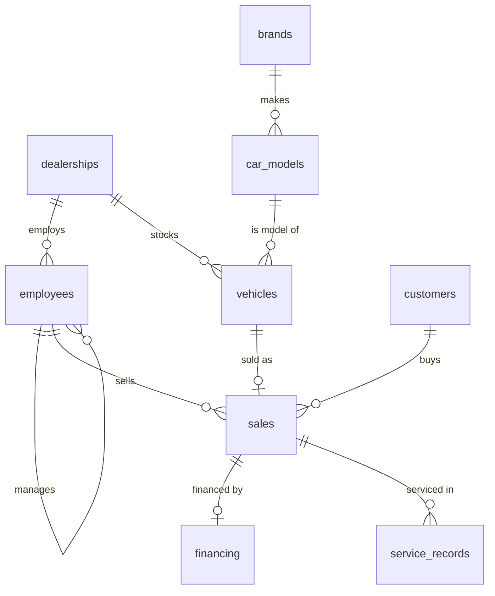

# Car Sales SQL Analysis

SQL analysis of a multi-dealership car retailer in Indonesia, built in **PostgreSQL**. The project answers real business questions from leadership, sales, marketing, operations, finance and after-sales teams using a 9-table relational database.

**Tools:** PostgreSQL 16 · DBeaver · SQL (CTEs, window functions, views)
**Data:** synthetic, Jan 2023 – Oct 2026 (see [Data note](#data-note))

---

## Business problem

A car retailer with 12 dealerships and 10 brands needs one source of truth for decisions. Each team asks different questions:

| Team | Question it needs answered |
|---|---|
| Leadership | How are revenue, profit and margin trending? Which brands carry the business? |
| Regional management | Which dealerships and provinces perform best? |
| Marketing | Who are our customers, who comes back, and who is worth the most? |
| Sales director | Who really hits target, and at what discount? |
| Operations | What is stuck on the lot, and where do we lose money? |
| Finance | How do customers pay, and what is our lender exposure? |
| Service | What do repairs cost, and who stops coming back? |


## Data model

About 4,000 sales, 4,400 vehicles, 3,700 customers, 3,000 financing contracts and 7,400 service visits across 9 tables.



Three helper views make the analysis readable:

- `v_sales_detail`: one row per sale with every dimension attached (brand, model, dealership, salesperson, customer, profit, days to sell)
- `v_purchase_events`: one row per customer per purchase day, so a company buying 3 cars in one day counts as **one** purchase occasion
- `v_params`: data cut-off date and last full year, so no query has a hardcoded date

## Repository structure

```
car-sales-sql-analysis/
├── README.md
├── sql/
│   ├── 01_schema_and_data.sql      -- creates the 9 tables and loads the data
│   └── 02_analysis_queries.sql     -- 3 views + analysis queries by business task
└── images/                         -- charts and screenshots (optional)
```

## How to run

1. Create an empty PostgreSQL database.
2. Run `sql/01_schema_and_data.sql`.
3. Run `sql/02_analysis_queries.sql` (Section 0 creates the views, then each query runs on its own).

With `psql`:

```bash
createdb carsales
psql -d carsales -f sql/01_schema_and_data.sql
psql -d carsales -f sql/02_analysis_queries.sql
```

With DBeaver: open the file, set the active connection to your database, and run it as a script (Alt+X).

## SQL skills demonstrated

| Skill | Where |
|---|---|
| Joins (inner, left, self) | Dealership, manager and customer queries |
| Aggregation, `FILTER`, `CASE` | KPIs, discount buckets, mix percentages |
| CTEs | Cohorts, RFM, target hit rate |
| Window functions (`RANK`, `LAG`, `NTILE`, running totals) | Brand rankings, YoY growth, moving averages, Pareto |
| Date logic and calendar spines (`generate_series`) | Target hit rate, new-hire ramp-up |
| Percentiles (`PERCENTILE_CONT`) | Median days to sell and days to repurchase |
| Views | Reusable reporting layer |
| Data quality checks | One-page PASS / WARNING / ERROR report, reconciliation |
| Indexing and `EXPLAIN ANALYZE` | Performance section |

## Key findings

Money is in IDR. The 2026 data covers January to October only, so growth is compared like-for-like.

**Company performance**
- **4,017 cars sold, IDR 1,322.5 bn revenue, IDR 123.9 bn gross profit, 9.4% margin.**
- Like-for-like growth (Jan to Oct each year) slows: **+21.1% in 2024, +19.7% in 2025, +7.0% in 2026.**
- **Toyota is 44.6% of revenue.** Hyundai is the only South Korean brand and has the best margin (11.2%).
- December (index 1.34), August (1.31) and March (1.19) are the strongest months. February is the weakest (0.72).
- Jakarta Pusat Motor alone is 15% of revenue.
  → *Recommendation: plan stock and staffing around the three peak months, and check whether the slowdown is real or a seasonal timing effect.*

**Customers**
- **27.9% of customers generate half of all revenue.**
- 19.4% of buyers return for a second purchase. Corporate customers buy 2.4 cars each, against 1.2 for individuals.
- Among customers whose first purchase was at least 2 years ago, those who **serviced their first car with us came back within 2 years 32.9% of the time, against 17.7% for those who never did.**
- Buyers under 30 pick a hatchback or EV 59.6% of the time, against 22.5% for buyers over 60.
  → *Recommendation: invite first-year buyers to service campaigns, and target young buyers with EV and hatchback offers.*

**Discounts and inventory**
- Discounts rise with the age of the car: **1.4% when sold within 30 days, 7.7% after 180 days. 20% of those old-stock deals lose money.**
- Exhibitions give the deepest discounts (3.8% of list price, against 1.7% in showrooms).
- 380 unsold cars tie up **IDR 124.9 bn**. 78 of them are older than 180 days (IDR 35.1 bn).
- The Mazda CX-5 has 12 cars in stock but sells 0.2 per month, which is **72 months of supply**.
  → *Recommendation: stop ordering slow models and move or clear old stock before the discount has to be 8% or more.*

**Sales team, financing and service**
- Counting months with zero sales, the target hit rate is **59%, against 76%** if empty months are ignored.
- New hires sell 0.5 cars per month in their first 3 months and 1.6 after a year.
- 76% of cars are financed. EV loans average **7.6% interest, against 8.4% for petrol.**
- Repair share grows from **9% at the first service visit to 34% at the fifth.** 24.5% of cars sold over a year ago never came back for service.

### Example: do discounts "work"?

Query 4.5 looks at how old a car was when it sold:

```sql
SELECT CASE WHEN days_to_sell <= 30  THEN '1) sold in 0-30 days'
            WHEN days_to_sell <= 90  THEN '2) 31-90 days'
            WHEN days_to_sell <= 180 THEN '3) 91-180 days'
            ELSE '4) 180+ days' END AS stock_age_when_sold,
       COUNT(*) AS units,
       ROUND(100.0 * SUM(discount_amount) / SUM(list_price), 2) AS discount_pct,
       ROUND(100.0 * COUNT(*) FILTER (WHERE gross_profit < 0) / COUNT(*), 1) AS loss_deal_pct
FROM v_sales_detail
GROUP BY 1
ORDER BY 1;
```

| Stock age when sold | Units | Discount % | Loss-making deals % |
|---|---|---|---|
| 0 to 30 days | 1,676 | 1.41 | 0.0 |
| 31 to 90 days | 1,854 | 2.11 | 0.0 |
| 91 to 180 days | 402 | 3.58 | 1.7 |
| 180+ days | 85 | 7.70 | 20.0 |

**Insight:** discounts are mostly a symptom of slow stock, not a sales tool. The business should fix ordering, not just discount harder.

## Data note

The data is **synthetic**. It was generated with a script that follows realistic business patterns: seasonality, EV growth, customers buying near home, brand loyalty, and bigger discounts on aging stock. The findings above describe this dataset and **are not real market statistics**. The project is meant to show SQL and analytical thinking, not to report on a real company.

## What I would do next

- Build a Power BI or Looker Studio dashboard on top of `v_sales_detail`
- Forecast monthly revenue using the seasonal index
- Add a stored procedure that runs the data-quality report on a schedule

## Ringkasan (Bahasa Indonesia)

Proyek ini menganalisis data penjualan mobil dari 12 dealer menggunakan **PostgreSQL**. Basis datanya terdiri dari 9 tabel dan menjawab pertanyaan bisnis dari tim pimpinan, penjualan, pemasaran, operasional, keuangan, dan layanan purna jual. Temuan utama: Toyota menyumbang 44,6% pendapatan, diskon terbesar diberikan pada stok yang sudah lama (7,7% setelah 180 hari), dan pelanggan yang servis di dealer lebih sering membeli lagi (33% dibanding 18%). Data bersifat sintetis.

## Author

**<Your Name>** · [LinkedIn](<your-linkedin-url>) · [GitHub](<your-github-url>)
